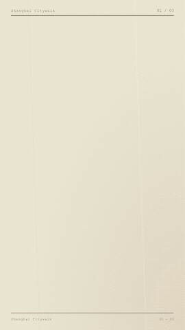
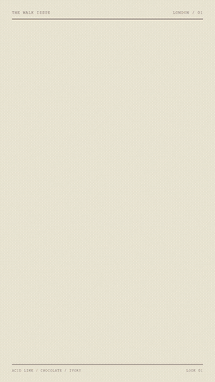
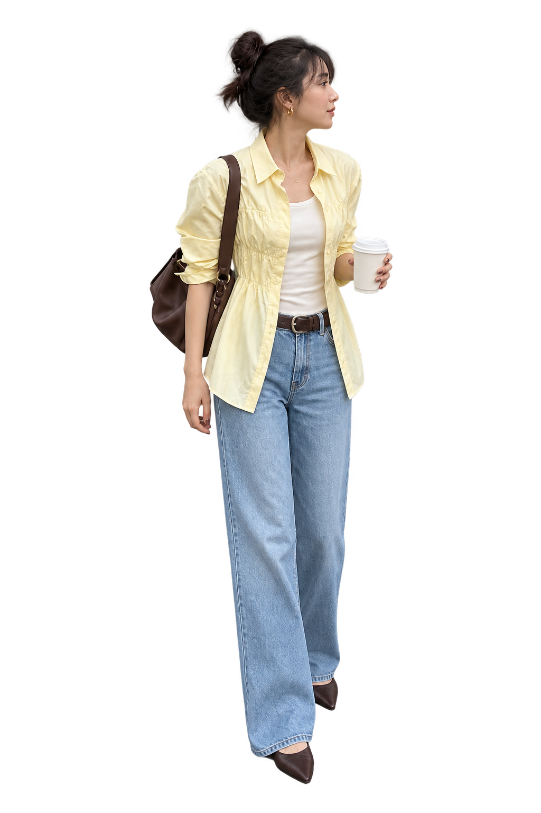
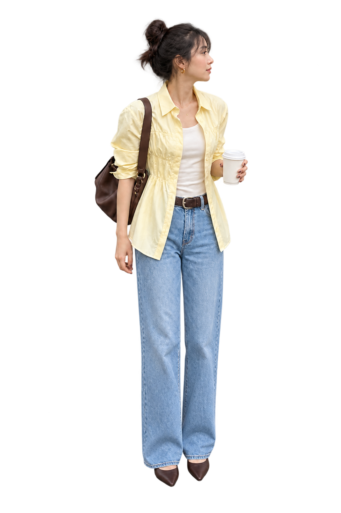
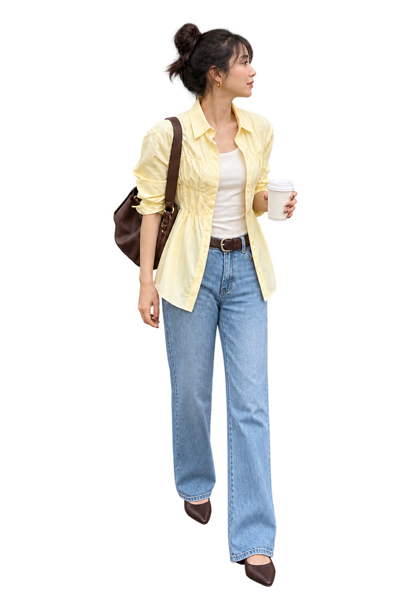
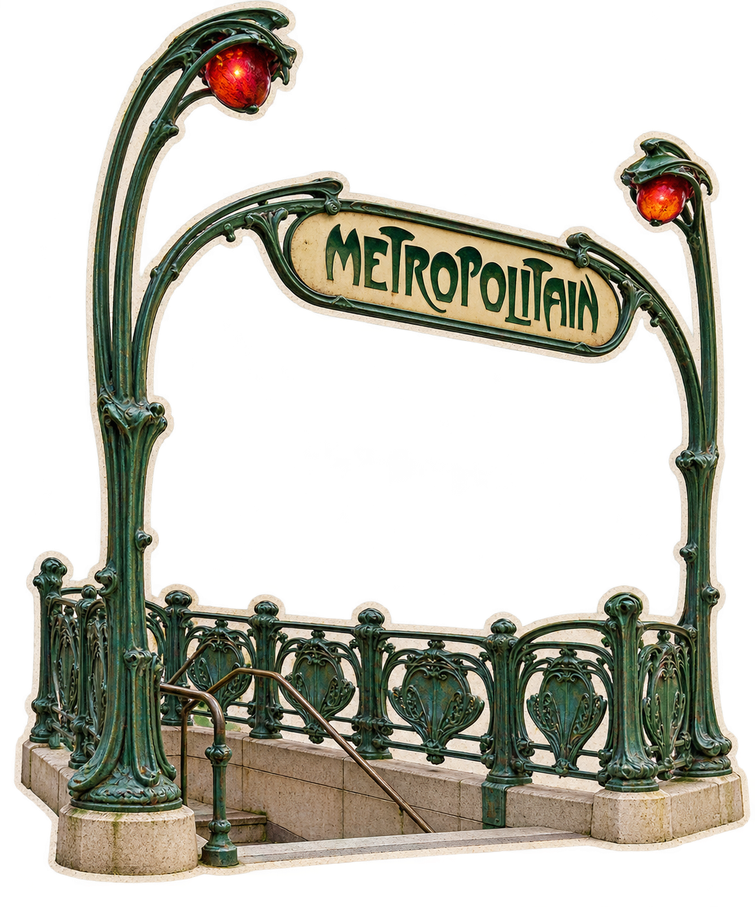
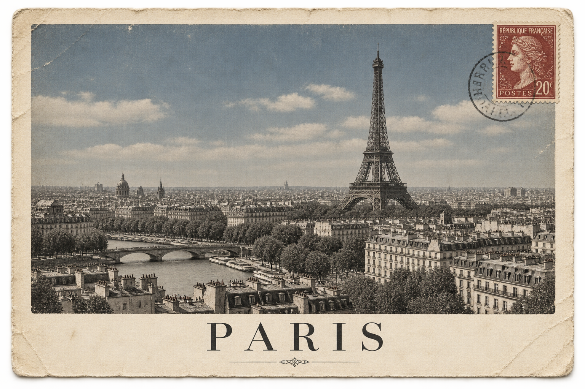

# 纸片剧场 · Paper Cutout Story

**给一张人物图，让 TA 走进由照片、报纸和贴纸搭起来的世界。**

一套可供生图型 agent 使用的开放制作技能：参考拆解 → 创意与分镜 → 同人动作图 → 城市/场景贴图 → 纸边与剪字 → 动作循环 → 道具转场 → 检查与导出。包含真实案例、完整资产和可编辑工程，而不只有提示词。

[开始使用](#开始使用) · [Agent 入口](SKILL.md) · [完整制作回顾](docs/process.md) · [全部视频/GIF](docs/gallery.md) · [全部图片目录](docs/assets.md) · [English](README.en.md)

## 成品预览

| 上海 · 12 秒 | 香港 · 52 秒 | 伦敦 · 15 秒 | 巴黎 · 9 秒 |
|:--:|:--:|:--:|:--:|
|  |  |  |  |
| [MP4](media/videos/shanghai-v2.mp4) · [工程](projects/shanghai-citywalk-v2) | [MP4](media/reference/paper-city-hong-kong-original.mp4) | [MP4](media/videos/london-v5.mp4) · [工程](projects/london-citywalk-v5) | [MP4](media/videos/paris-v2.mp4) · [工程](projects/paris-citywalk-v2) |

GIF 为完整时长、低分辨率无声预览，MP4 保留原始输出与声音。仓库收录 **12 个视频及对应 GIF、10 份阶段工程、75 张去重图片资产，另有 6 张用户提供的参考图**。早期版本和动作预览在[完整作品页](docs/gallery.md)；伦敦 v2 仅存在工作工程，没有伪造该版成片。

## 素材是什么样的

<table><tr><td></td><td></td><td></td><td></td></tr><tr><td>前迈 A</td><td>过渡 C</td><td>前迈 B</td><td>建筑碎片</td></tr><tr><td></td><td></td><td colspan="2"></td></tr></table>

所有图片均可在[图片索引](docs/assets.md)查找。去重库保留文件哈希与原工程别名；工程内也保留实际引用的图片，不依赖本机缓存路径。原始输入照片与设计参考单独放在 [assets/references](assets/references)。

## 这种形式的核心

- **少量人物姿态有序循环**：人物内部动作与整张贴图的运动轨迹分开控制。
- **场景在眼前逐件搭建**：道路、建筑、店面、交通设施、生活道具错时进入，形成活动而非海报。
- **图片道具带出转场**：报纸、明信片、咖啡杯、车辆等成为巨幅前景，遮住换场时刻。
- **统一的实体纸感**：薄纸边、轻影、哑光印刷与适量独立晃动；脸部保持干净。
- **镜头与文字有层次**：全身、半身、服装细节交替，报刊剪字有清楚阅读顺序。

不需要整段文生视频。图片生成器负责素材；时间线负责素材如何表演。不同城市应改变构图、路线、素材角色和收尾，而不只是替换标题。

## 开始使用

### 直接交给任意 agent

下载或克隆仓库，让 agent 读取根目录的 [SKILL.md](SKILL.md)。该文件用英文写核心执行规则，便于跨环境使用；本页和过程回顾用中文说明。

```text
读取 paper-cutout-story/SKILL.md。
以我提供的人物照片为主角，制作一条 9 秒巴黎 Citywalk 纸质拼贴短片。
人物正常左右迈步，使用过渡姿势；加入半身与服装细节。
转场只用一张明信片划过。标题 Paris Citywalk，输出 MP4、GIF、素材和工程。
先检查两轮人物动作，再继续完整制作，不必逐步等我确认。
```

### 安装为 skill

```bash
# Codex
 git clone https://github.com/cooperchx/paper-cutout-story.git ~/.codex/skills/paper-cutout-story
```

Claude Code 等支持 skills 的环境可放入其技能目录；无法自动发现技能的 agent 直接阅读 `SKILL.md` 即可。已有同名目录时先保留原版本，不要覆盖。也可以只复制技能说明、references、scripts、templates 和 agents 目录作轻量安装，示例媒体按需获取。

### 有哪些工具就走哪条路

| 你的 agent 能力 | 可完成的交付 |
|---|---|
| 生图／图片编辑 | 人物动作组、城市贴图、分镜、提示词、时间线配方 |
| 生图 + Node + Chromium/Puppeteer + FFmpeg | 使用附带 Canvas 模板导出 MP4 与 GIF |
| 生图 + 剪辑软件 | 按同一分层与时序制作，用软件导出 |
| 已有合格素材 + 合成能力 | 直接复用，不强制再生图 |

**不绑定某个模型、付费插件或视频生成服务。只有生图功能时，不能直接声称已编码出视频。** 透明输出、参考图编辑和身份一致性取决于所用生成器，替代路线见[能力适配](references/capabilities.md)。

## 可选：本地可执行模板

安装 Node 22.12+、Python 3（分析/GIF脚本）、FFmpeg；Puppeteer 安装会准备 Chromium。普通浏览器预览不需要 Puppeteer。

```bash
npm install
python3 -m http.server 8000
# 浏览器打开 http://localhost:8000/templates/player.html
```

另一个终端导出：

```bash
node scripts/render.mjs examples/paris-portable.json rendered/paris.mp4
python3 scripts/make_gif.py rendered/paris.mp4 rendered/paris.gif --width 270 --fps 12
```

示例 JSON 演示完整9秒、三场景、三姿态循环、单图遮挡与音轨。它是可移植实现示例，**不是历史 HyperFrames 成片的逐像素复刻**。换自己的图片和文字即可修改；具体字段见[渲染说明](references/rendering.md)。原始制作工程仍完整保存在 `projects/`。

## 如何适配不同需求

支持分析参考、只出人物图、只做贴纸、生成完整视频、局部修正与跨城市改版。人物穿搭、旅行、咖啡/食品、产品展示都可使用；产品不套人物步态规则。时长、比例、语言、主体数量与动作复杂度按需求决定，不固定为9秒或三场景。[适配决策表](references/adaptation.md)

## 最重要的修正经验

1. **姿态数量不等于动作正确。** 必须看到左右腿真正交换，不可镜像整个人代替。
2. **错误解剖不能靠合成拉伸补。** 巴黎 v2 重新生成人物图，取消下半身独立缩放。
3. **仅滑动一张人物图不等于走路。** 校园初试保留作反例。
4. **地点需要生活内容。** 伦敦 v5 补入道路、地铁、出租车、电话亭、书店花店、咖啡桌椅。
5. **转场看不透明像素。** 包围盒满屏仍可能从车窗、边角漏出下一场。

全部用户反馈、判断与改法在[过程回顾](docs/process.md)。其他 agent 可以先阅读失败和修正，再开始生成。

## 仓库结构

```text
SKILL.md                   通用执行入口
references/                步态、提示词、构图、能力适配、合成与检查
scripts/ + templates/      抽帧、GIF、无框架浏览器渲染
examples/                  可运行时间线示例
projects/                  10 份实际制作阶段工程和完整引用资产
assets/                    75 张去重图片、6 张参考输入、来源索引
media/videos/ + gifs/       11 个原始 MP4 与完整 GIF 预览
docs/                      制作回顾、全部作品、图片索引、验证报告
```

## 验证与许可

[验证报告](docs/agent-validation.md)记录打包完整性、原输出媒体参数和独立渲染路径测试。数值检查不代替视觉审美判断，也不表示试听过音轨。

原创技能文本与代码采用 [MIT](LICENSE)。第三方照片、字体、GSAP 和示例媒体的范围另见 [ATTRIBUTION.md](ATTRIBUTION.md)；MIT 不扩大人物肖像、品牌或原照片权利。公开包移除了本机专有字体，工程改用系统回退；历史 MP4/GIF 保持原样。
