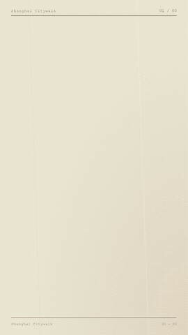
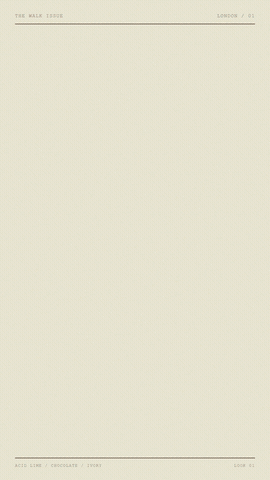
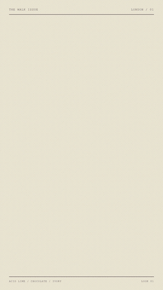
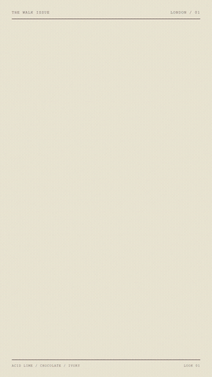
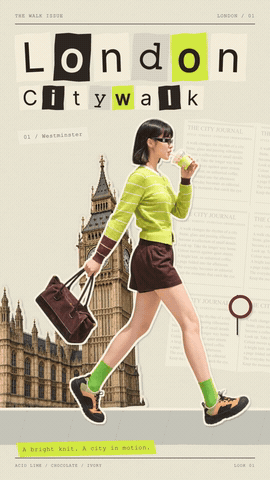
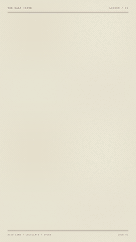
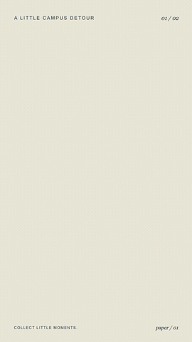

# 全部成片与迭代预览

所有已交付且在工作区找到的视频均保留原MP4，并提供完整时长GIF。失败尝试不是推荐模板；请结合[制作回顾](process.md)。

## 上海 v1

12.00 秒 · 1080×1920

[原始 MP4](../media/videos/shanghai-v1.mp4) · [GIF](../media/gifs/shanghai-v1.gif)

## 上海 v2｜晃动与道具转场

12.00 秒 · 1080×1920

[原始 MP4](../media/videos/shanghai-v2.mp4) · [GIF](../media/gifs/shanghai-v2.gif)

## 伦敦 v1｜初版

15.00 秒 · 1080×1920

[原始 MP4](../media/videos/london-v1.mp4) · [GIF](../media/gifs/london-v1.gif)

## 伦敦 v3｜两帧步态尝试

15.00 秒 · 1080×1920

[原始 MP4](../media/videos/london-v3.mp4) · [GIF](../media/gifs/london-v3.gif)

## 伦敦 v4｜增加过渡姿态

15.00 秒 · 1080×1920

[原始 MP4](../media/videos/london-v4.mp4) · [GIF](../media/gifs/london-v4.gif)

## 伦敦｜两轮步态预览

2.00 秒 · 540×960

[原始 MP4](../media/videos/london-three-pose-loop.mp4) · [GIF](../media/gifs/london-three-pose-loop.gif)

## 伦敦 v5｜城市逐件搭景

15.00 秒 · 1080×1920

[原始 MP4](../media/videos/london-v5.mp4) · [GIF](../media/gifs/london-v5.gif)

## 巴黎 v1｜步态待修正

9.00 秒 · 1080×1920

[原始 MP4](../media/videos/paris-v1.mp4) · [GIF](../media/gifs/paris-v1.gif)

## 巴黎 v2｜正常左右交替

9.00 秒 · 1080×1920

[原始 MP4](../media/videos/paris-v2.mp4) · [GIF](../media/gifs/paris-v2.gif)

## 红衣人物｜四姿态预览

4.00 秒 · 720×1080

[原始 MP4](../media/videos/red-outfit-pose-loop.mp4) · [GIF](../media/gifs/red-outfit-pose-loop.gif)

## 校园初试｜静态纸偶反例

5.50 秒 · 1080×1920

[原始 MP4](../media/videos/campus-first-test.mp4) · [GIF](../media/gifs/campus-first-test.gif)

## 用户提供的原始参考（另列）

约52秒，香港主题，5个主体场景＋造型回顾＋群像收尾。不是本项目新制作的成片。

[原始MP4](../media/reference/paper-city-hong-kong-original.mp4) · [段落与城市识别](reference-video.md)
