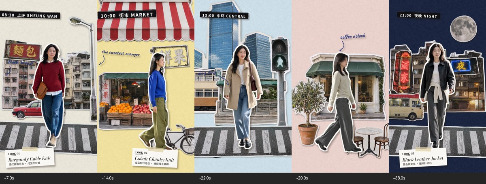
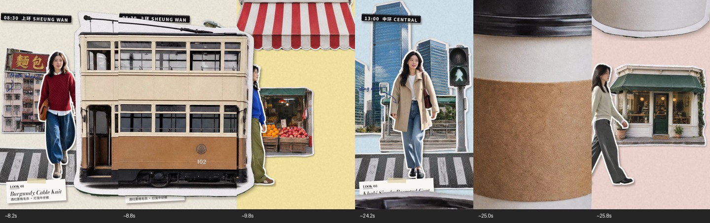
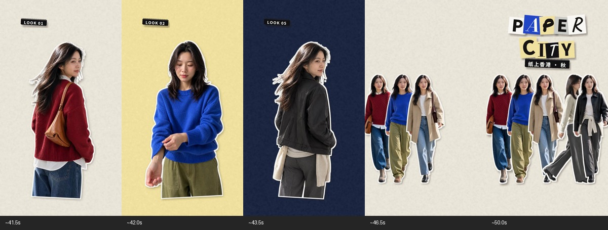

> 历史阶段记录：描述当时的状态；当前方法与最终交付以仓库根目录说明为准。

> **2026-10-31 修正**：首版试片未实现人物姿态循环，偏离原参考。连续帧复核发现检查段中正面约 4 姿态、侧面约 6 姿态，约 1 秒循环。复现应优先采用离散姿态贴图，保持城市穿搭 vlog 主线。详见 [逐帧复核结论](逐帧复核/复核结论.md)。

# 纸片剧场：参考视频拆解与 Skill

你的判断抓住了主要方向：这类效果适合用“照片／图片素材＋抠图＋分层合成”制作。人物还有连续姿态变化，因此若要接近参考片，应该补充短动作抠像或多姿态序列，而不只是拿一张人物图平移。仅凭成片无法确定原作者到底使用了多少 AI、哪些软件或是否实拍。

它可以概括成：**一个持续出现的主角，在不断组装的纸片世界里经历变化；场景里的物件负责把世界翻到下一页。**

## 五个场景的共同规则

米白、暖黄、浅蓝、粉色、深蓝分别承载五段城市生活。照片人物占据主要视觉位置；背景由楼房、店面、路灯、招牌和桌椅碎片组成。它追求的是剪贴簿的平面关系，不是一个透视和尺度完全真实的城市。

白边与细影让照片看起来是放在纸上的剪片；背景纸纹保持低对比，让衣服的色彩和材质先被看到。黑底时间标签、白底产品卡、手写旁注各司其职，不与主角争夺注意力。

## 转场是最有价值的创意机制

电车由右向左，巴士由左向右，咖啡杯从下往上，咖啡纸页再绕竖轴转出。它们都与前后场景有关，既带来视觉变化，也解释“接下来去哪儿”。杯子在咖啡场景出现之前就预告了主题。

制作时，道具在最前景运动，后面场景以切换或方向遮罩更替。需要检查道具边缘、车窗和画幅四周：道具的包围框覆盖全屏，不等于不透明像素覆盖全屏。不能让观众从空隙中看到场景突然跳变。

## 人物不是静止贴纸

加密抽帧可以看到迈腿、摆臂、头发和衣摆变化。背景与身体内部动作是两层不同的问题：

- 环境、道路、招牌、车辆：大多可以用静态图片的移动、缩放、遮罩和层级完成。
- 人物自然步行、转身、整理袖口：需要姿态序列或短动作素材；也可以拍好后抠像。
- 标题、时间标签、产品卡：独立排版，再作为纸片动画。
- 整体昼夜变化：换纸色、照片碎片和服装，不必生成连续写实环境。

如果只提供一张人物图，可以做有意的纸偶滑行、点跳或轻摆；这能保留拼贴趣味，但运动质感会与原片不同。

## 节奏和结尾

大部分场景先让主角出现，再添环境与信息，留一段稳定展示，最后由道具带走。不能把“有趣”理解为所有元素同时抖动。正面步行与侧面步行交替，让场景的观看方向有变化。

约 41 秒后进入造型近景快切，再到部分全身造型，最后五套人物陆续集合、标题重新拼好。前半段让人逛城市，后半段让人记住衣服，最后把经历收集成一张封面。

## 完整时间表与观察依据

## 证据范围

用户提供的本地参考片：`虎小象-服装片或者其他片子想剪下面这个效果_提示_10368kbps-20261018235024.mp4`。媒体参数：1080×1920、标称 24 fps、1246 个视频帧；视频约 51.917 秒，容器含音频约 51.966 秒。

本次检查全片每秒 2 帧的 104 个样本，并对正面／侧面步行、电车、咖啡杯、翻页以每秒 12 帧加密观察，末尾快切以每秒 6 帧观察。以下时间是观察定位，非逐帧剪切点。未试听音轨，未分析音乐节拍。

**能看见的事实**：照片式人物与建筑有浅色轮廓；人物腿、手、头发和衣摆发生变化；城市碎片、道路、招牌、标签有独立运动；转场有巨型交通工具、咖啡杯和纸页旋转。**实现推断**：可以通过抠像动作素材／姿态序列与图片分层合成复现。不能由成片确认实拍、AI 生成、模型名称、具体软件或原片是否全由静态图制作。

## 段落表

| 约时间 | 可见内容 | 可复用的导演方法 |
|---|---|---|
| 0–3s | 米白纸，剪字 PAPER CITY、纸上香港·秋，酒红针织人物正面迈步；道路先进入 | 先建立主角与标题，再逐件搭世界；不是先铺满背景 |
| 3–8s | 老楼、面包招牌、路灯、红的士；08:30 上环 SHEUNG WAN；Look 01 产品卡 | 以少数地方符号建立场景；人物处于视觉中心，环境与信息逐步加入 |
| 约8.1–9.8s | 大电车由右向左穿越前景，离开后露出黄色纸页和蓝色衣服 | 将场景内的交通工具变成转场装置；以大尺寸反差制造趣味 |
| 约9.8–15.7s | 黄色纸、红白遮篷、果摊、鲜果招牌、自行车；蓝针织＋绿裤人物侧面走；10:00 街市 MARKET | 正面与侧面形成节奏差；上方遮篷和中下方碎片提供舞台边界 |
| 约15.7–17.8s | 巨型双层巴士由左向右扫过，背后换浅蓝场景 | 同一种遮挡语法，改变方向和道具，保持连贯而不完全重复 |
| 约17.8–24.2s | 浅蓝纸、玻璃高楼、地铁入口式建筑碎片、行人灯、路面；卡其外套正面走；13:00 中环 CENTRAL | 从街市进入商务空间，以服装、纸色、建筑同时说明变化 |
| 约24.2–25.9s | 超大外带咖啡杯从下方上移，随后露出粉色咖啡场景 | 道具预告下一场；转场本身承担叙事 |
| 约25.9–32.8s | 粉纸、绿篷咖啡店、盆栽、桌椅、coffee o’clock 注记；浅色针织侧面走；16:00 咖啡 COFFEE | 用静物补充生活情境；不需要真实街道透视也能成立 |
| 约32.8–33.3s | 咖啡整页绕竖轴转窄并移出，露出深蓝夜景 | 整场作为纸页预合成，再做有限透视旋转；不是单件道具遮挡 |
| 约33.3–41.3s | 深蓝纸、夜间老楼、月亮、霓虹招牌、小巴；黑外套正面走；21:00 夜晚 NIGHT | 用纸色与场景碎片完成昼夜变化；保持主角与平面剪纸规则 |
| 约41.3–45.3s | 五套造型半身快速轮换，随后出现部分全身造型快切 | 先体验场景，再用短促近景回顾衣服、包和姿态；全身回顾并非每套都出现 |
| 约45.3–49.3s | 米白底，五套人物陆续集合，剪字标题重新拼回 | 把之前出现的元素收集成结尾，建立首尾呼应 |
| 约49.3–51.9s | 群像、标题、纸上香港·秋停留，末尾印章式标记与变暗 | 让观众读完结尾；不是最后一件元素刚落地就结束 |

## 它为什么好玩

1. **真实照片住进假的纸片世界。** 保留人物衣服的照片细节，但压扁场景深度，形成视觉反差。
2. **场景在观众眼前被装起来。** 道路、楼、招牌、路灯和小卡片错时进入，观众能感到“贴”的行为。
3. **小道具获得大权力。** 一辆车、一杯咖啡可以遮住整个世界并把它换掉。
4. **同一个人串联一天。** 服装变化与城市路线互相解释，避免成为无关穿搭的机械轮播。
5. **正面／侧面交替。** 城市场景以正面人物为主，街市与咖啡场景用侧面行进，画面有方向变化。
6. **信息本身也是纸片。** 黑色时间胶带、白色产品卡、剪字标题、手写小旁注组成明确的层级。
7. **最后把经历收集回来。** 快切回顾和群像将分散的场景变成一套作品。

## 可继承与不必继承

继承：素材与合成分离、主角连续性、逐件搭景、场景道具转场、有限平面层次、清楚的信息阅读、收尾回收。

可替换：城市、人物、服装、纸色、时刻、标题排法、造型数量、车辆种类、朝向、时长。不要把白描边或“港风”误认成全部创意。

人物帧间的内部变化说明单张静态人物平移不足以复现此片；但这不等于必须整段 AI 视频生成。可将短动作素材抠像，再与大量静态纸片合成。

## 已整理成什么 Skill

名称：**纸片剧场 / `paper-cutout-story`**。

技能包包含：

- `SKILL.md`：何时使用、创意骨架、制作流程、人物素材选择与检查标准。
- `references/reference-study.md`：本参考片的观察范围、时间表与创意分析。
- `references/compositing.md`：图层、描边、人物循环、遮挡和翻页的实现方法。
- `references/creative-recipes.md`：新主题迁移、单资产提示词与分镜格式。
- `scripts/inspect_video.py`：带时间标签的抽帧联系表工具，便于继续学习其他参考片。
- `agents/openai.yaml`：技能在界面中的名称和调用提示。

这是一套创意与制作指导技能，附视频分析工具；不是独立的一键渲染器。真正制作新片时，会使用当前可用的图像、抠像和时间线工具。本次没有调用付费生图／视频任务，也没有制作新的成片。

可以这样调用：

> 用 $paper-cutout-story，把我提供的三套穿搭做成 20 秒竖屏短片：从通勤、逛市场到喝咖啡。保留照片剪纸质感和场景道具转场，先做素材清单与分镜，再继续制作。

或者：

> 用 $paper-cutout-story，给这款咖啡做一条纸片拼贴短片。让咖啡豆、杯子、办公桌和野餐场景串起来，产品包装保持准确，先输出创意和分镜。

要延续这个形式，最重要的是“可拆分素材＋连贯主角＋有意义的场景变化”，而不是重复香港、五套衣服或同一辆电车。
