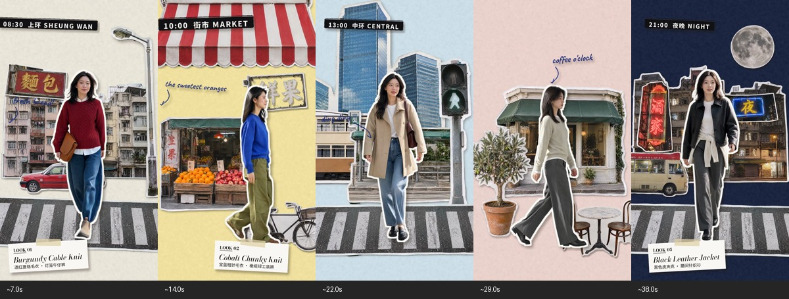
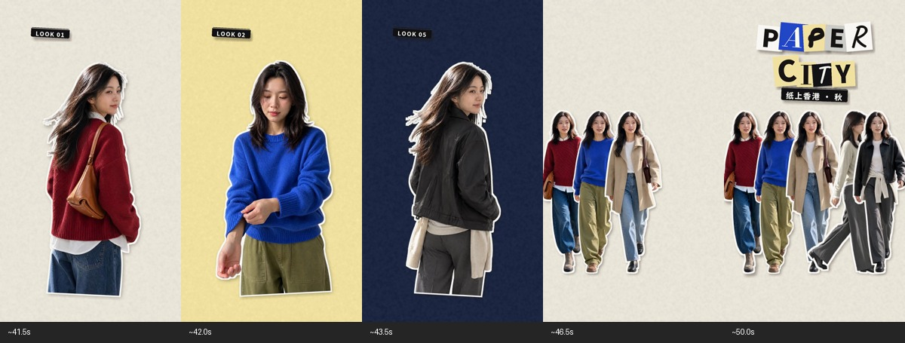

# 原参考视频：香港的一天

[完整原视频 MP4](../media/reference/paper-city-hong-kong-original.mp4) · [完整 GIF 预览](../media/reference/paper-city-hong-kong-preview.gif) · [机器可读段落清单](../media/reference/catalog.json)

这是用户最初提供、用于学习创意形式的参考片，保留原文件字节与音轨，单独归类为参考素材，不混入本项目新制作的11个视频。

## 有几段、属于哪些城市？

**1 个城市主题：香港。5 个主体场景，加上2个收尾段，共7个内容段。** 开场并入上环段；四次道具/纸页转场单列，不算新增城市。片名与结尾明确写着“纸上香港·秋”。

|段落|约时间|场景/画面标签|城市与区域判断|
|---|---|---|---|
|1|0–8.1秒|开场＋08:30 上环 SHEUNG WAN|香港·上环，文字明确|
|2|9.8–15.7秒|10:00 街市 MARKET；黄纸、果摊、遮篷|香港主题下的街市场景；具体街市未标明|
|3|17.8–24.2秒|13:00 中环 CENTRAL；蓝纸、高楼、行人灯|香港·中环，文字明确|
|4|25.9–32.8秒|16:00 咖啡 COFFEE；粉纸、咖啡店与桌椅|香港主题下的咖啡场景；店名/区域未标明|
|5|33.3–41.3秒|21:00 夜晚 NIGHT；深蓝纸、霓虹与小巴|香港主题夜景；具体街区未标明|
|6|41.3–45.3秒|五套穿搭半身/全身快切|前述香港行程的造型回顾，不是新城市|
|7|45.3–51.9秒|五套人物集合、PAPER CITY、纸上香港·秋|香港主题总结，结尾标题明确|

这些时间是视觉段落的近似定位，不冒充逐帧精确剪切点。“香港”是影片表达的地点；拼贴素材本身可能来自不同来源，不能由成片证明每张照片都实拍于香港。上环和中环是区域名称，街市/咖啡/夜晚是场景或活动名称，不是另三个城市。

## 五个主体场景的证据

## 标题与结尾的城市证据

咖啡段本次另查看31秒画面，确认“16:00 咖啡 COFFEE”。其余场景结合已保存的全片联系表与连续帧复核确认。

## 四次转场

|约时间|转场素材/动作|衔接|
|---|---|---|
|8.1–9.8秒|巨型电车横向穿过|上环 → 街市|
|15.7–17.8秒|巨型双层巴士横扫|街市 → 中环|
|24.2–25.9秒|巨型咖啡杯上移|中环 → 咖啡|
|32.8–33.3秒|整场纸页翻转|咖啡 → 夜晚|

这些转场负责同城行程推进，并不表示跨城市移动。可学习它们的遮挡与叙事关系，不必在别的城市重复同一辆车或同一时间表。

## 素材信息与使用边界

原视频1080×1920，24fps，1246视频帧；画面约51.917秒，含音频容器约51.966秒。GIF是216px宽、8fps的完整时长无声预览，不能替代原视频作逐帧分析。原视频哈希记录在JSON，未重新编码或改写。

原作者/权利方未独立核实，按用户要求作为参考收录；不列入原创代码的MIT授权。没有把原参考音轨当成本项目原创配乐，也未声明识别出其音乐或制作软件。[更多创意拆解](../references/reference-study.md) · [动作连续帧观察](../references/frame-audit.md)
